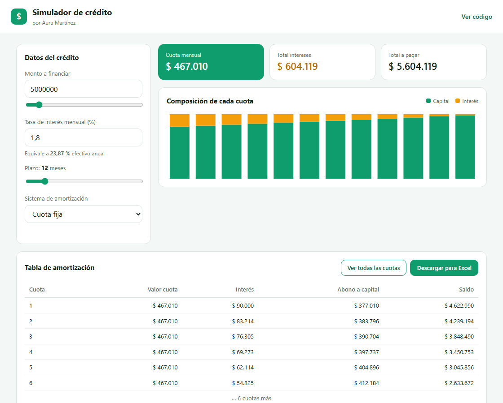

# Simulador de crédito

Simulador de crédito con tabla de amortización, hecho en **HTML, CSS y JavaScript puro**, sin frameworks ni librerías.

**Demo:** https://aurachico.github.io/simulador-credito-js/



## Qué hace

- Calcula la cuota a partir del monto, la tasa mensual y el plazo.
- Maneja dos sistemas de amortización:
  - **Cuota fija** (sistema francés): la cuota es la misma todos los meses.
  - **Abono fijo a capital** (sistema alemán): el abono a capital es constante y la cuota baja cada mes.
- Muestra el total de intereses, el total a pagar y la tasa efectiva anual equivalente.
- Dibuja un gráfico con la parte de capital y de interés de cada cuota (SVG generado desde JavaScript).
- Genera la tabla de amortización completa y la descarga en un archivo que abre Excel.
- Se adapta a celular y escritorio.

## Cómo se calcula

Cuota fija:

```
cuota = monto × tasa / (1 − (1 + tasa)^−plazo)
```

En cada cuota, el interés es `saldo × tasa` y el resto de la cuota abona a capital.

Tasa efectiva anual:

```
tasa anual = (1 + tasa mensual)^12 − 1
```

## Cómo ejecutarlo

No necesita instalación. Clona el repositorio y abre `index.html` en el navegador.

```bash
git clone https://github.com/AURACHICO/simulador-credito-js.git
```

## Estructura

```
index.html   estructura de la página
styles.css   estilos y diseño responsive
app.js       cálculo, gráfico, tabla y exportación
```

## Autora

Aura Martínez — [LinkedIn](https://www.linkedin.com/in/aura-mart%C3%ADnez-995a5722b) · [GitHub](https://github.com/AURACHICO)

Los valores son una simulación y no constituyen una oferta de crédito.
